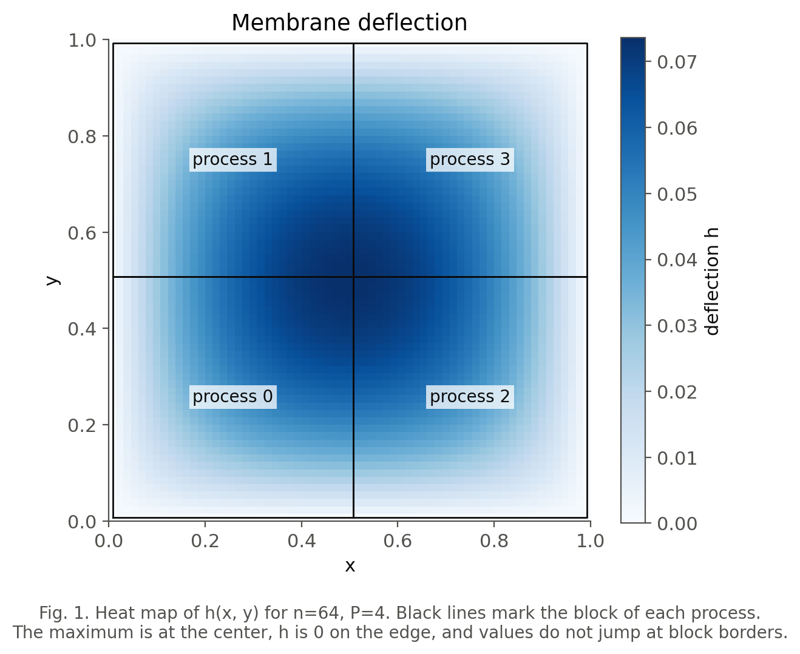
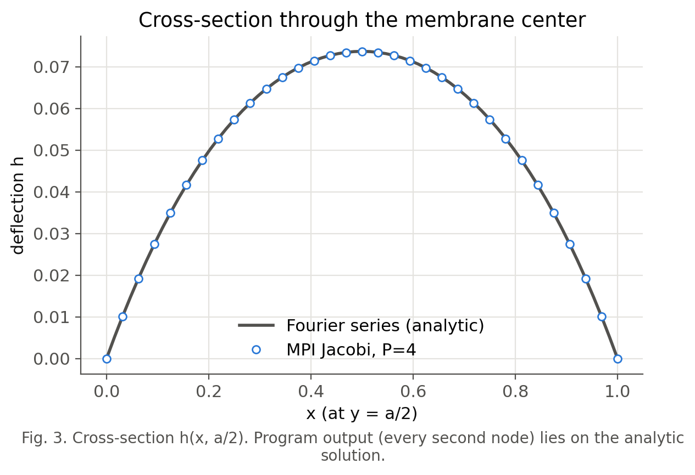
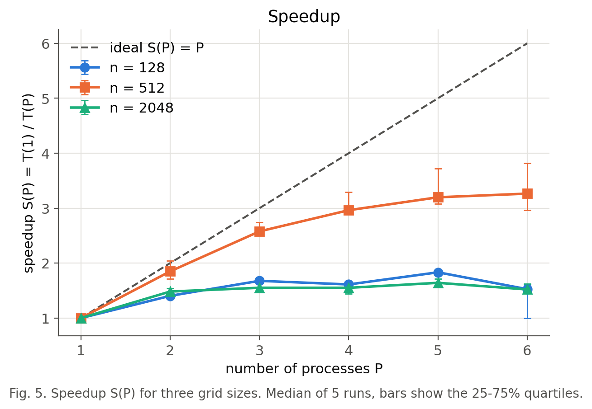
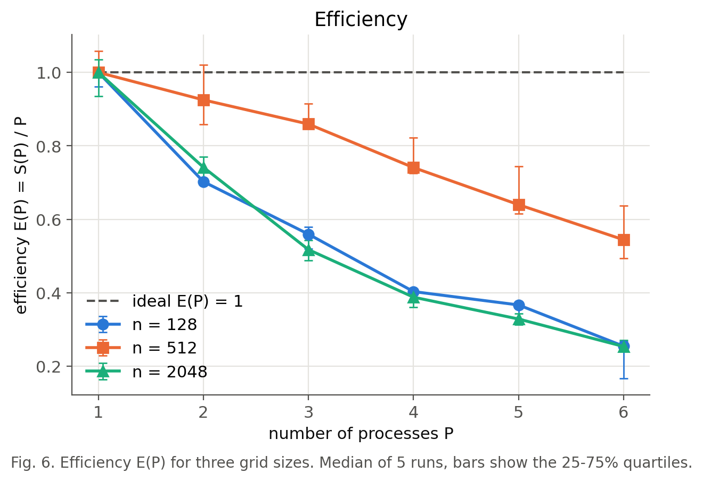
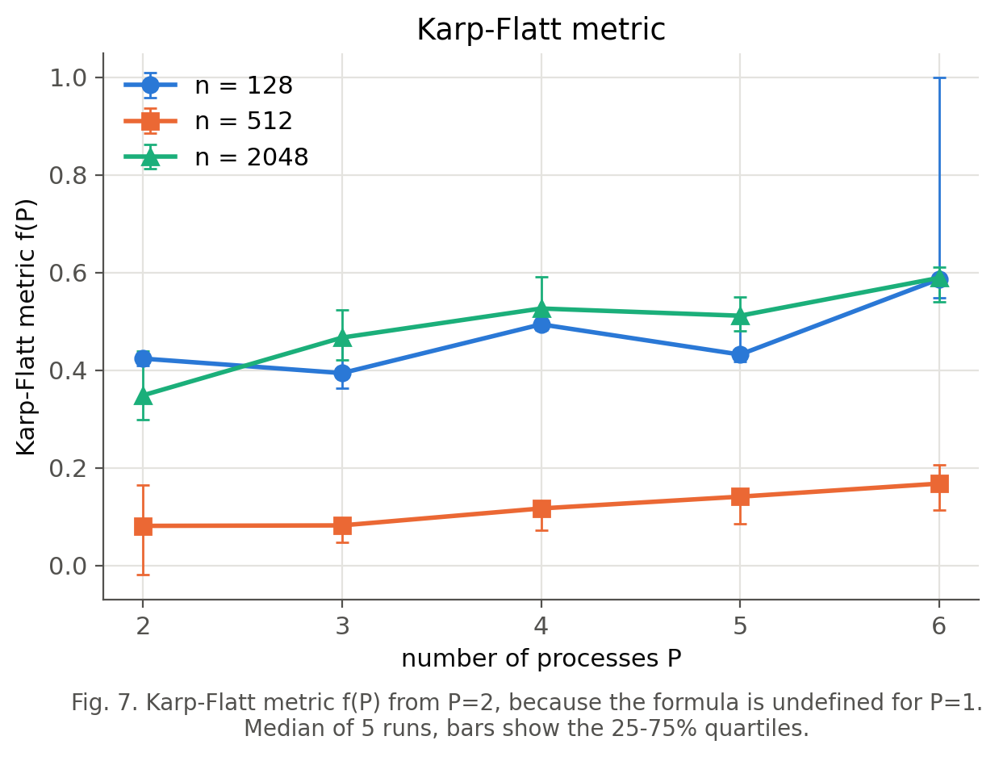
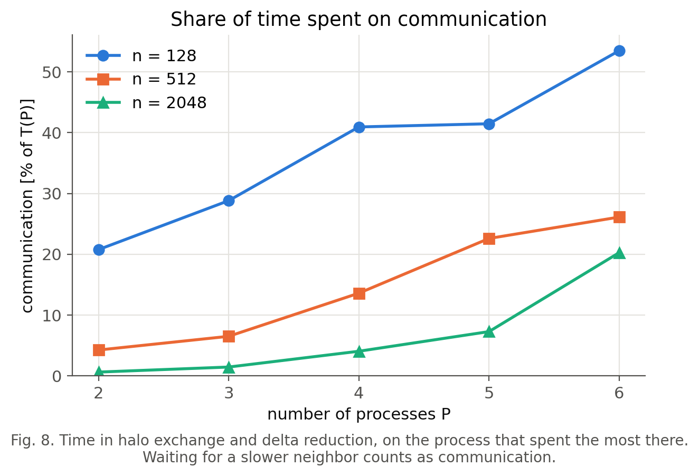

# Sprawozdanie: laboratorium 3

Filip Pawłowicz, Artur Gęsiarz

Napisaliśmy równoległą wersję metody Jacobiego dla ugięcia membrany z laboratorium 1 i zmierzyliśmy ją na 1–6 procesach. Program daje poprawne wyniki. Najlepsze przyspieszenie to 3,27 na 6 procesach, dla siatki n=512. Siatka n=2048 przyspiesza tylko około 1,5 raza, bo procesy spowalniają się nawzajem przy dostępie do pamięci.

## Program

Program `jacobi_mpi.py` jest napisany w Pythonie z mpi4py i realizuje Algorytm 1 z `algorytm_opis.pdf`. Każdy proces dostaje jeden blok siatki i dodatkową warstwę węzłów (halo) na wartości od sąsiadów. W każdej iteracji proces wymienia z sąsiadami wiersze i kolumny przez `Sendrecv`, a potem liczy nowe wartości ze wzoru (7). Co m iteracji `Allreduce` wyznacza globalne δ. Bloki przy brzegu membrany mają sąsiada `MPI.PROC_NULL`, więc ich halo zostaje zerowe, czyli spełnia warunek brzegowy.

Projekt zakłada siatkę procesów √P × √P, ale program działa dla każdego P. Dla P = 2, 3, 5, 6 używa układów 2×1, 3×1, 5×1 i 3×2. Pierwsza wersja pętli tworzyła w każdej iteracji tymczasowe tablice NumPy. Po przejściu na operacje w miejscu czas dla n=2048 na jednym procesie spadł w pojedynczym porównaniu z 21 s do 8 s. Bez tej zmiany T(1) byłoby zawyżone przez koszt alokacji, a przyspieszenie wyglądałoby na lepsze, niż jest.

Wszystko uruchamialiśmy lokalnie, na Intel Core i5-9400F (6 rdzeni bez hyper-threadingu, 9 MB pamięci L3) z Windows 10, Intel MPI 2021.19 i mpi4py 4.1.2. Polecenie do lab 3 nie wymaga klastra. Skrypt `ares_job.sh` na klaster Ares jest przygotowany, ale nie był uruchamiany.

## Poprawność wyników

Test działał na siatce n=64 z a = p = T = 1, do δ < 10⁻¹⁰. Każde P od 1 do 6 zakończyło się po 11460 iteracjach i dało dokładnie tę samą siatkę: największa różnica względem P=1 wynosi 0,0. To najmocniejszy dowód, że wymiana halo działa, bo jeden zły wiersz zmieniłby wartości przy granicy bloków.

Wynik zgadza się też z rozwiązaniem analitycznym w postaci szeregu Fouriera. W środku membrany program daje 0,073657, a szereg 0,073671. Największy błąd na siatce to 1,42·10⁻⁵. Dla n = 16, 32, 64, 128 każde zagęszczenie siatki zmniejsza błąd około czterokrotnie, a wyliczony rząd zbieżności to 1,99, 2,00 i 1,99, tak jak przewiduje schemat (5).





Wykres powierzchni 3D i wykres zbieżności są w `figures/fig2_surface.png` i `figures/fig4_convergence.png`.

## Wydajność

Mierzyliśmy trzy siatki przy stałej liczbie iteracji: n=128 (20000 iteracji), n=512 (3000) i n=2048 (200). Liczba iteracji nie zależy od P, więc dla danego n praca jest zawsze taka sama. Każda wartość to mediana z 5 pomiarów. T(1) wynosi 2,68 s, 5,22 s i 8,29 s, a T(6) odpowiednio 1,76 s, 1,60 s i 5,45 s.

Komórki tabeli zawierają kolejno S(P) / E(P) / f(P).

| P | n=128 | n=512 | n=2048 |
|---|---|---|---|
| 2 | 1,40 / 0,70 / 0,42 | 1,85 / 0,93 / 0,08 | 1,48 / 0,74 / 0,35 |
| 3 | 1,68 / 0,56 / 0,39 | 2,58 / 0,86 / 0,08 | 1,55 / 0,52 / 0,47 |
| 4 | 1,61 / 0,40 / 0,49 | 2,96 / 0,74 / 0,12 | 1,55 / 0,39 / 0,53 |
| 5 | 1,83 / 0,37 / 0,43 | 3,20 / 0,64 / 0,14 | 1,64 / 0,33 / 0,51 |
| 6 | 1,53 / 0,25 / 0,59 | 3,27 / 0,54 / 0,17 | 1,52 / 0,25 / 0,59 |









## Skąd biorą się straty

Dla n=128 największy koszt to komunikacja, która przy P=6 zajmuje 53% czasu. Blok ma tam tylko około 2700 węzłów, więc liczenie trwa krótko w porównaniu z wymianą halo. Zauważalny jest też stały koszt każdej iteracji. Czas obliczeń na iterację dobrze opisuje wzór 24 µs + 6,1 ns · liczba węzłów w bloku, a różnica względem pomiarów dla P = 2–5 wynosi najwyżej 3%. Te 24 µs to prawdopodobnie narzut Pythona i NumPy, którego nie da się podzielić między procesy. Wzór wyznaczyliśmy z pomiarów dla P=1 i P=6, bez osobnego testu narzutu.

Siatka n=512 skaluje się najlepiej. Komunikacja rośnie do 26% przy P=6, a czas obliczeń na węzeł zmienia się tylko z 6,6 ns do 9,0 ns.

Przy n=2048 komunikacja zajmuje tylko 20% czasu przy P=6, a mimo to S(6) = 1,52. Czas obliczeń na węzeł rośnie tam z 9,9 ns do 31,1 ns, czyli około 3,1 raza. Sama ta strata ogranicza S(6) do około 1,9 (6 / 3,1), a komunikacja obniża wynik dalej.

Żeby sprawdzić, czy winna jest pamięć, uruchomiliśmy `memory_test.py`. Skrypt startuje kilka niezależnych kopii programu, które w ogóle się nie komunikują, i mierzy czas jednej kopii przy stałej pracy. Mediana z 9 powtórzeń wygląda tak:

| Liczba kopii | Mały blok (n=209) | Duży blok (n=836) |
|---|---|---|
| 1 | 1,00 | 1,00 |
| 2 | 1,02 | 1,47 |
| 4 | 1,07 | 2,73 |
| 6 | 1,35 | 4,15 |

Sześć kopii małego bloku potrzebuje razem około 6 MB na tablice i mieści się w 9 MB pamięci L3. Sześć kopii dużego bloku potrzebuje około 100 MB, więc cały czas sięga do RAM-u, który wszystkie rdzenie dzielą. Spowolnienie pojawia się bez MPI, więc powoduje je sprzęt. Test nie rozdziela wpływu L3 i RAM-u, pokazuje tylko ich łączny efekt.

Metryka f(P) ogólnie rośnie z P, choć dla n=128 nierówno. Przy stałej części sekwencyjnej krzywa byłaby płaska, więc wysokie wartości f (0,59 przy P=6 dla n=128 i n=2048) opisują głównie narzuty komunikacji i pamięci.

## Ograniczenia pomiarów

Mamy dane tylko dla 6 rdzeni jednego komputera, więc nie widać zachowania przy dużym P ani komunikacji przez sieć. Na Aresie problem z pamięcią może być mniejszy, ale tego nie sprawdziliśmy.

W trakcie pomiarów działały inne programy, m.in. przeglądarka. Niektóre przebiegi trwały kilka razy dłużej od mediany, np. 17,9 s zamiast 1,76 s dla n=128 i P=6. Nie ustaliliśmy przyczyny tych skoków. Mediana je pomija, a w tabeli w notebooku są widoczne w kolumnie `T_max`. Słupki na wykresach pokazują kwartyle 25–75%.

## Uwagi do projektu

W `algorytm_opis.pdf` warto poprawić dwa miejsca. Sekcja 2.3 uzasadnia zbieżność dominacją przekątniową, ale macierz jest dominująca tylko słabo: w środku siatki 4 = 1 + 1 + 1 + 1. Do dowodu trzeba dodać, że jest też nieredukowalna.

Ta sama sekcja podaje kryterium δ < ε, które nie ogranicza błędu do ε. Błąd iteracji jest rzędu δ / (1 − ρ), co dla n=64 daje około 830·δ. W naszym teście to około 8·10⁻⁸, czyli dużo mniej niż błąd schematu 1,42·10⁻⁵, ale przy większym ε lub gęstszej siatce różnica może mieć znaczenie.

## Uruchomienie

Pomiary i test pamięci uruchamia się skryptami, a `lab03.ipynb` zawiera wszystkie wykresy i tabele. Do ręcznego użycia `mpiexec` jego katalog musi być w PATH, po instalacji z pip to `%APPDATA%\Python\Library\bin`.

```
pip install mpi4py impi-rt
mpiexec -n 4 python jacobi_mpi.py --n 64
python benchmark.py
python memory_test.py
```
